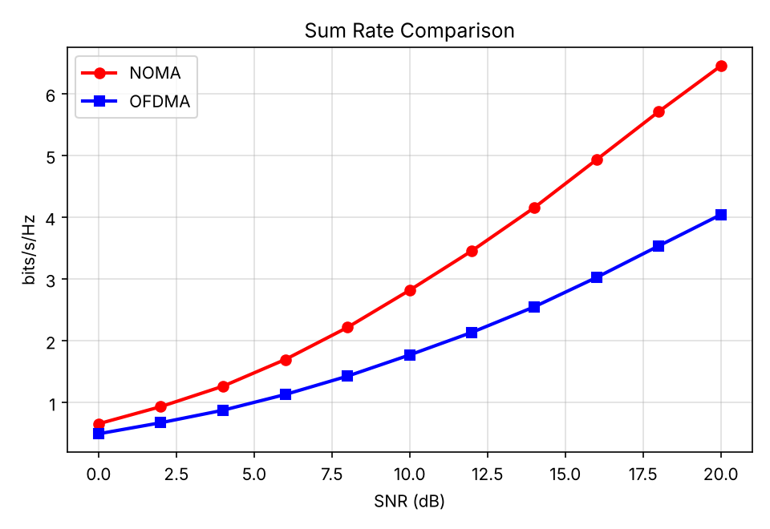
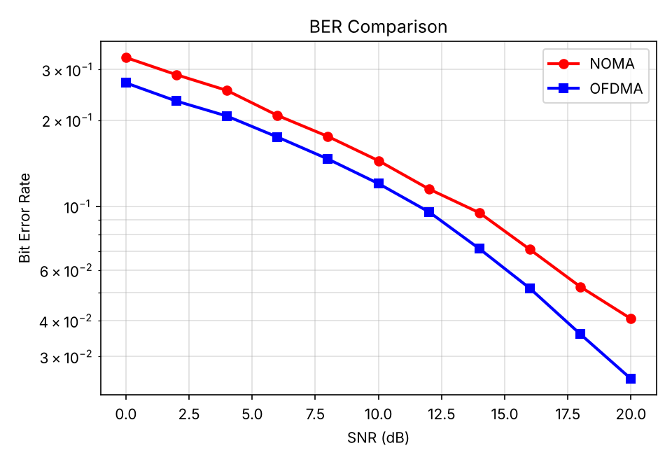
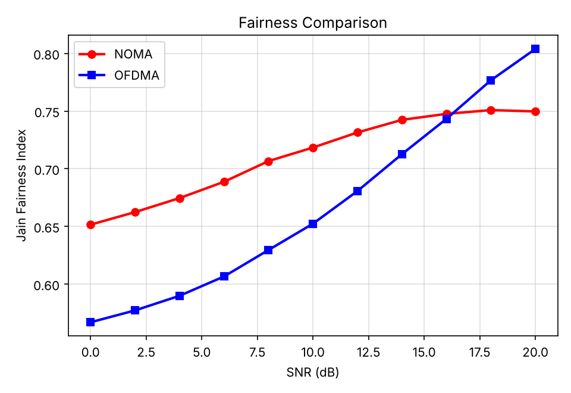
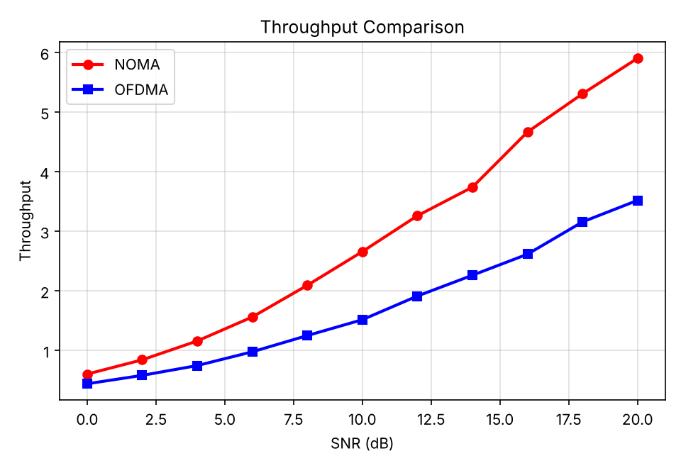
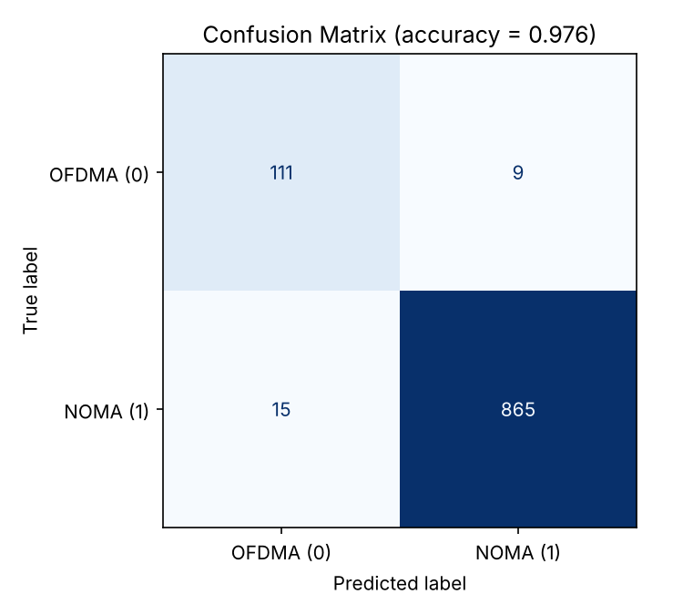
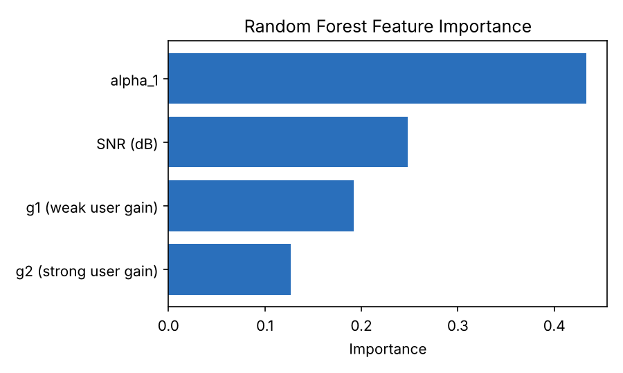

# NOMA vs OFDMA: Performance Analysis for 5G NR Networks

A comparative performance analysis of **Non-Orthogonal Multiple Access (NOMA)** and **Orthogonal Frequency Division Multiple Access (OFDMA)** for spectral efficiency enhancement in 5G NR wireless networks, with a Random Forest model that predicts the better access technique from channel conditions.

## Overview

A two-user downlink scenario under Rayleigh fading is simulated in MATLAB, comparing:

- **Spectral efficiency (sum rate)** in bits/s/Hz
- **Bit error rate (BER)**
- **Jain's fairness index**
- **Throughput**

A Random Forest classifier is then trained on simulated channel conditions (SNR, channel gains, power allocation) to choose between NOMA and OFDMA adaptively.

## Results

All figures below are generated by the scripts in this repo and stored in [`results/`](results/).

### Simulation: NOMA vs OFDMA (SNR 0-20 dB)

| Sum rate | BER |
|:---:|:---:|
|  |  |

| Fairness | Throughput |
|:---:|:---:|
|  |  |

| Metric | Observation |
|--------|-------------|
| Sum rate / spectral efficiency | NOMA is higher at every SNR, and the gap widens with SNR (6.45 vs 4.04 bits/s/Hz at 20 dB). |
| BER | OFDMA is lower throughout. NOMA pays for its rate with inter-user interference and SIC error propagation. |
| Fairness | NOMA is fairer at low-to-mid SNR. OFDMA overtakes it at about 16 dB and reaches 0.80 vs 0.75 at 20 dB. |
| Throughput | NOMA is higher despite its higher BER, because of its spectral-efficiency advantage. |

Raw numbers: [`results/simulation_results.csv`](results/simulation_results.csv).

### Machine learning: adaptive access selection

Random Forest classifier (150 trees, 80:20 split, 5000 samples, 1000 test samples). Label `1` = NOMA gives the higher sum rate, `0` = OFDMA does.

| Confusion matrix | Feature importance |
|:---:|:---:|
|  |  |

| Class | Precision | Recall | F1 |
|-------|-----------|--------|----|
| OFDMA (0) | 0.88 | 0.93 | 0.90 |
| NOMA (1) | 0.99 | 0.98 | 0.99 |

**Accuracy: 97.6%.** Full output: [`results/classifier_report.txt`](results/classifier_report.txt).

> **Note on reproducibility:** the datasets are random draws, so exact numbers vary between runs. The project report quotes 96.8% accuracy from its own draw of the dataset; running the committed `data/dataset.csv` gives the 97.6% shown above. The trends and conclusions are the same.

## Project Structure

```
.
├── simulation/
│   ├── noma_ofdm_main.m        # Main MATLAB simulation (BER, SE, fairness, throughput) + ML dataset
│   ├── noma_ofdm_main.py       # Python port of the above; generates the plots in results/
│   ├── generate_dataset.m      # Alternative classification dataset generator
│   └── dataset_nomaofdm.m      # Regression dataset generator (rate difference)
│
├── ml/
│   ├── classifier/
│   │   ├── train_model.py      # Train the Random Forest classifier, save model
│   │   ├── evaluate.py         # Confusion matrix, feature importance, report -> results/
│   │   └── predict.py          # Inference on sample inputs
│   └── regressor/
│       └── train_regressor.py  # Random Forest regressor for the rate difference
│
├── data/
│   ├── dataset.csv             # Classification data: SNR, g1, g2, alpha_1, label
│   └── noma_ofdm_dataset.csv   # Regression data: SNR, users, rate difference
│
├── docs/references/            # Reference papers
├── results/                    # Generated plots, metrics and CSVs
├── requirements.txt
└── README.md
```

## Getting Started

### Prerequisites

- **Python** 3.8+
- **MATLAB** R2020a+ (optional; only needed to run the `.m` scripts, since a Python port is included)

### Setup

```bash
git clone https://github.com/Anushka030205/NOMA-vs-OFDMA-5G-Performance-Analysis.git
cd NOMA-vs-OFDMA-5G-Performance-Analysis
pip install -r requirements.txt
```

### Reproduce the results

```bash
# Simulation plots (sum rate, BER, fairness, throughput) -> results/
python simulation/noma_ofdm_main.py

# Classifier metrics, confusion matrix, feature importance -> results/
python ml/classifier/evaluate.py
```

### Train the models

```bash
# Classifier (writes noma_ofdm_model.pkl in the current directory)
cd ml/classifier
cp ../../data/dataset.csv .
python train_model.py
python predict.py

# Regressor
cd ../regressor
cp ../../data/noma_ofdm_dataset.csv .
python train_regressor.py
```

### Run in MATLAB

```matlab
run('simulation/noma_ofdm_main.m')   % plots + regenerates dataset.csv
```

## System Model

| Parameter | Value |
|-----------|-------|
| Users | 2 (one near, one far) |
| Channel | Rayleigh fading (weak user scale 0.3, strong user scale 1.5) |
| Modulation | BPSK |
| Total power | 1 (normalized) |
| NOMA power allocation | a1 = 0.75 (far user), a2 = 0.25 (near user), SIC at the near user |
| OFDMA | Equal power split, orthogonal subcarriers |
| SNR range | 0 - 20 dB |

## ML Pipeline

Input features: SNR (dB), weak-user gain `g1`, strong-user gain `g2`, far-user power coefficient `alpha_1`. Output: `1` (NOMA better) or `0` (OFDMA better).

## Tools & Technologies

MATLAB, Python, NumPy, pandas, scikit-learn, matplotlib, joblib

## Author

**Anushka Vishal Chandergi** (23BEC0157)
B.Tech Electronics and Communication Engineering, VIT Vellore, School of Electronics Engineering

## License

Academic project for the Wireless and Mobile Communication course at VIT Vellore.
